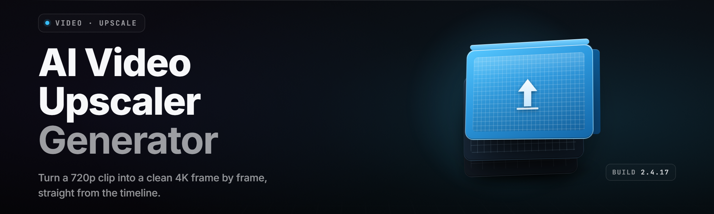

  
  
  

  

  
  

---

Real-time and batch AI video upscaling for archived footage, screen recordings, and DSLR clips. One `.exe`, no dependencies, drag-and-drop pipeline.

---

## 🎞️ Table of Contents

- [Overview](#-overview)
- [What is AI Video Upscaler Studio — Term | Explanation](#-what-is-ai-video-upscaler-studio--term--explanation)
- [All Modules Status](#-all-modules-status)
- [Quick Start — Run the Tool](#-quick-start--run-the-tool)
- [The Problem](#-the-problem)
- [The Solution](#-the-solution)
- [Grouped Module Catalog](#-grouped-module-catalog)
- [Key Features](#-key-features)
- [Usage Guidelines](#-usage-guidelines)
- [Get Started](#-get-started)
- [Tips for Best Results](#-tips-for-best-results)
- [Comparison — Aspect | Alternative | This Tool](#-comparison--aspect--alternative--this-tool)
- [Known Issues](#-known-issues)
- [Compatibility / Platform Support](#-compatibility--platform-support)
- [System Requirements](#-system-requirements)
- [FAQ](#-faq)

---

## 📽️ Overview

| Category | Details |
|---|---|
| Product | AI Video Upscaler Studio 2026 |
| Distribution | Windows `.exe` — portable, no installer required |
| Engine | TensorRT + ONNX Runtime (CUDA 12.x) |
| Input formats | MP4, MKV, MOV, AVI, WEBM, MPEG-TS, ProRes |
| Output formats | MP4 (H.264/H.265/AV1), MKV, PNG sequence |
| Batch model | Queue-based, GPU-pipelined, resumable |
| Upscale factors | 2×, 3×, 4×, native, custom scaling curve |
| Pipeline features | Denoise → Deinterlace → Upscale → Grain → Encode |
| Telemetry | Fully offline — no cloud calls, no account |

AI Video Upscaler Studio is a self-contained Windows application for restoring and upscaling video using modern diffusion and GAN-based models. It replaces a stack of fragmented tools — ffmpeg scripts, ESRGAN forks, VapourSynth chains — with a single graphical pipeline that queues jobs, previews frames in real time, and exports industry-standard containers.

---

## 🧪 What is AI Video Upscaler Studio — Term | Explanation

| Term | Explanation |
|---|---|
| Upscale factor | Multiplier applied to source resolution — 2× turns 720p into 1440p, 4× turns 480p into 1920p |
| Model (checkpoint) | Neural network weights (`.onnx`) specialized for a class of content: anime, live-action, CGI, VHS, DSLR grain |
| Tile size | Region of a frame fed to the GPU per inference pass; smaller tiles = lower VRAM, slower throughput |
| Temporal consistency | Frame-to-frame stability pass that suppresses flicker and ghosting across a sequence |
| Denoise strength | Amount of noise/grain removal applied before upscaling; higher values clean MPEG artifacts, lower values preserve grain |
| Deinterlace mode | Combing removal for interlaced sources (DV, DVD, broadcast); EEDI2 and NNADI2 selectable |
| Grain synthesis | Adds realistic film grain back after upscaling to avoid a plastic/waxy result |

Key benefits:

- Restores legacy 480p/576p footage to modern 4K playback without a cloud subscription.
- Runs entirely offline — frames never leave the workstation.
- Queue survives reboots; interrupted jobs resume from the last completed segment.
- Preset library tuned per content type means no per-project parameter archaeology.
- GPU memory manager dynamically resizes tiles, so a 6 GB card and a 24 GB card both work.
- Deterministic output — the same source + preset produces bit-comparable frames.

---

## 🛰️ All Modules Status

| Module | Status | Description |
|---|---|---|
| `upscale-core` | ✅ Working | Inference engine — ONNX Runtime session, tile scheduler |
| `temporal-stabilizer` | ✅ Working | Optical-flow flicker suppression across frames |
| `denoise-prepass` | ✅ Working | Spatial + temporal denoiser before upscaling |
| `deinterlace-node` | ✅ Working | EEDI2 / NNADI2 deinterlacing for interlaced sources |
| `color-pipeline` | ✅ Working | LUT-friendly linear pipeline, YUV↔RGB conversion |
| `grain-synth` | ✅ Working | Post-upscale film grain injection with presets |
| `encode-mux` | ✅ Working | FFmpeg HW-accelerated encoder + mux wrappers |
| `batch-queue` | ✅ Working | Queue manager — resume, retry, priority |
| `preview-scrubber` | ✅ Working | Before/after frame slider at any timeline point |
| `preset-library` | ✅ Working | Curated presets: VHS, DVD, Broadcast, Anime, CGI |
| `audio-passthrough` | ✅ Working | Copy or re-encode audio without pipeline rebuild |
| `chapter-preserver` | ✅ Working | Retains original container chapters on export |
| `metadata-carry` | ✅ Working | Copies XMP/Exif, rotates, colorspace tags |
| `multi-gpu-scheduler` | 🧪 Beta | Distributes tiles across heterogeneous GPUs |
| `remote-render-farm` | 🧪 Beta | LAN render worker discovery and job sharding |
| `av1-export` | ✅ Working | AV1 hardware encode via NVENC / QSV |
| `plugin-loader` | ✅ Working | Loads third-party custom upscaler models |
| `profiler` | ✅ Working | Per-stage timing + VRAM watermark log |
| `log-inspector` | ✅ Working | Structured logs with grep-copy search bar |
| `scene-detect-splitter` | ✅ Working | Auto-split inputs at hard cuts for shot-specific tuning |
| `interlace-autoflag` | ✅ Working | Detects interlacing and flags jobs at queue time |
| `gpu-memory-manager` | ✅ Working | Dynamic tile resizing based on live VRAM pressure |
| `cli-bridge` | ✅ Working | Headless invocation for scripted pipelines |

---

## 🎬 Quick Start — Run the Tool

1. 🔽 Download the archive from the project page and extract it to a folder you can write to (not `Program Files`).
2. 🖱️ Double-click the `.exe` — the launcher verifies GPU drivers and drops you at the main window.
3. 📂 Drag a video file onto the queue panel, or click **Add Media**.
4. 🧩 Pick a preset: **VHS Restore**, **Anime 4×**, **DVD → 1080p**, or **DSLR Grain Preserve**.
5. ▶️ Click **Run Queue**. Progress, ETA, VRAM, and per-stage timing appear live in the monitor strip.

First job previews two frames; if output looks right, hit **Process All** to chew through the queue.

---

## 🪫 The Problem

- Consumer upscalers crush fine detail into waxy mush — faces look like wax museum rejects.
- Legacy VHS and DVD encodes carry combing, dot crawl, and macroblocking that most models amplify instead of suppress.
- Cloud upscalers cost per-minute, upload gigabytes, and cap your turnaround by queue position.
- Per-shot tuning is a nightmare — a batch of interviews mixed with b-roll needs different models on each shot.
- Hobbyist pipelines require chaining ffmpeg, VapourSynth, ESRGAN forks, and a prayer.
- Growing an output to 4× on a midrange GPU either OOMs or forces snail-slow CPU fallback.
- No tool faithfully preserves chapters, audio tracks, or color metadata across a full re-encode.

---

## 🏗️ The Solution

| Problem | Solution |
|---|---|
| Waxy detail loss | Content-aware models with separate anime/live-action/CGI checkpoints |
| Legacy artifacts | Denoise + deinterlace prepass before any upscale stage |
| Cloud cost & privacy | Fully offline `.exe`; frames never leave the machine |
| Per-shot tuning | Scene-detect splitter + per-shot preset overrides in queue |
| Pipeline sprawl | One GUI wrapping every stage; ffmpeg bundled internally |
| VRAM ceiling | Dynamic tile scheduler keeps inference under the live budget |
| Metadata destruction | Chapter and metadata carry-through on export by default |

---

  

---

## 🧩 Grouped Module Catalog

### **Restoration & Cleaning**

The restoration block handles dirty sources before any scaling happens. Denoise runs temporal and spatial passes in parallel; deinterlace picks the right kernel automatically for DV, DVD, and broadcast fields. Color pipeline stays in linear space so LUTs feel predictable.

- **Pre-denoise** — separates MPEG macroblocks from genuine film grain
- **EEDI2 / NNADI2** — deinterlacing with either CPU-exact or neural approximation
- **Blotch repair** — removes analog dropout streaks
- **Chroma stabilization** — stops chroma smear from bleeding forward

### **Upscaling & Synthesis**

Upscaling is the heart of the tool. The engine runs per-tile inference on GPU, swapping checkpoints depending on frame classification. Temporal stabilizer runs after the upscaler, not before, so flicker correction operates on clean pixels.

- **Tile scheduler** — GPU-aware, resizes tiles under VRAM pressure
- **Temporal flow pass** — RAFT-based forward/backward consistency check
- **Grain synth** — recomposes 35mm, 16mm, and CCTV grain profiles
- **Adaptive model routing** — per-frame classifier picks model family

### **Encoding & Mux**

Encoding preserves as much as it produces. Chapter markers, multiple audio tracks, subtitle streams, and rotation tags all survive the pipeline by default. Encoders spawn HW-accelerated sessions on supported GPUs.

- **NVENC / QSV / AMF** — hardware encoders picked from availability
- **AV1 export** — RTX 40/50 and Arc series
- **Audio passthrough** — copy stream verbatim or re-encode to AAC/Opus
- **Subtitle lift** — embedded ASS/SSA/UTF8 subs preserved as-is

### **Workflow & Queue**

Queue handling is what separates a tool from a prototype. Interrupted jobs resume, priorities reshuffle, and render farms over LAN spread the load without a cloud broker.

- **Resume checkpoint** — every N segments, atomic state flush
- **Priority reshuffle** — drag-reorder queue without killing in-flight work
- **Render farm daemon** — worker discovery via mDNS on LAN
- **CLI bridge** — feed pipelines from batch scripts and schedulers

### **Diagnostics & Profiler**

Nothing ships silently. Every stage timestamps itself, VRAM watermark spikes get logged, and the diagnostic bus collates failures with a copy-paste bug report block.

- **VRAM watermark log** — peak / avg / ceiling per job
- **Stage timeline** — ms per stage, per frame, per tile
- **Structured JSON logs** — grep-friendly, tooltip-summarized
- **Export bug report** — one click, sanitized, no telemetry

### **Plugin Layer**

The plugin loader accepts user `.onnx` and `.engine` files. A manifest declares input shape, scale factor, and color order so custom models integrate without a rebuild.

- **Manifest `.ups-model`** — declares shape, scale, colorspace
- **Hot reload** — drop new checkpoint, no restart required
- **Sandboxed execution** — no network calls from plugins
- **Signing** — optional, blocks unsigned models with a warning

---

## 💠 Key Features

| Feature | Description | Benefit |
|---|---|---|
| Preset library | VHS, DVD, Broadcast, Anime, CGI, DSLR | Zero-tune output that looks intentional |
| Scene splitter | Splits inputs at hard cuts | Per-shot models on heterogeneous timelines |
| Temporal stabilizer | RAFT flow consistency | Flicker-free animated and camera-pan sequences |
| Dynamic tile scheduler | Resizes tiles under VRAM pressure | Mid-GPU cards carry 4× jobs without OOM |
| Fully offline | No network calls at runtime | Private, portable, works air-gapped |
| Batch resume | Atomic state flush per segment | Overnight jobs survive power loss and reboots |
| Metadata carry | Chapters, tags, tracks preserved | No re-tagging sessions after export |
| Multi-GPU scheduling | Split tiles across mixed GPUs | Uses the 3090 and 4090 in one machine |
| Render farm | LAN worker discovery | Scale across spare desktops on the LAN |
| CLI bridge | Headless invocation | Fits into existing batch scripts |
| AV1 export | HW-accelerated on RTX 40/50, Arc | Half the file size at equivalent quality |
| Plugin loader | Custom `.onnx` models | DIY checkpoints integrate cleanly |

---

## 📋 Usage Guidelines

| Allowed | Not allowed |
|---|---|
| Restoring personal archives and home video | Distributing modified copies of commercial releases |
| Upscaling original footage you shot | Circumventing DRM or copy protection |
| Academic and technical benchmarking | Repackaging the `.exe` as your own product |
| Streaming your upscaled footage | Sharing presets bundled with pirated media |
| Research on upscaler model quality | Using the plugin loader to wrap malicious payloads |

---

## 🧷 Get Started

1. Grab the archive via the download block above or below.
2. Extract to a folder like `C:\Tools\UpscalerStudio\`. The `.exe` is portable and writes its config next to itself.
3. First launch auto-probes the GPU, verifies CUDA runtime presence, and stages the default checkpoints.
4. Drop a video, pick a preset, and click **Run Queue**.
5. Read the monitor strip — VRAM watermark, per-stage timing, and ETA are all live. If anything sours, the log inspector has it.

---

## 🩹 Tips for Best Results

- Match the preset to the source content type — never upscale VHS with an anime model.
- Run deinterlace **first** on anything labeled 480i/576i; combing becomes permanent otherwise.
- Leave grain synthesis on for anything film-originated — a fully clean upscale reads as CG.
- Split mixed timelines with the scene detector and assign per-shot presets.
- Keep tile size under half your VRAM watermark — the scheduler resizes dynamically but smaller tiles hedge.
- Use AV1 export if the destination is a modern browser or media server.
- Preserve audio with passthrough unless the source needs cleanup.
- Benchmark one shot end-to-end before queuing an entire season.

---

## ⚖️ Comparison — Aspect | Alternative | This Tool

| Aspect | Alternative | This Tool |
|---|---|---|
| Where processing happens | Cloud SaaS, upload per clip | Local `.exe`, offline |
| Cost model | Per-minute subscription | One-time download |
| Legacy formats | Poor — models assume clean source | Dedicated VHS / DVD restore prepass |
| Per-shot tuning | Global settings only | Scene splitter + per-shot presets |
| VRAM handling | OOM on non-flagship cards | Dynamic tile scheduler |
| Metadata preservation | Chapters/audio often dropped | Chapter + audio + tag carry-through |
| Custom models | Locked to vendor catalog | Plugin loader accepts `.onnx` |
| Interrupted job recovery | Restart from zero | Resume from last segment |

---

## 🧯 Known Issues

| Issue | Solution |
|---|---|
| `NVENC not available` at startup | Update NVIDIA driver to 55x or newer; the encoder caps must be checked |
| Very slow first frame | First frame stages CUDA kernels; subsequent frames run 6–20× faster |
| Choppy preview on high-bitrate input | Reduce preview tile to 512 in Settings → Preview |
| Custom `.onnx` returns black frames | Check colorspace in `.ups-model` manifest — input expects linear RGB float32 |
| Multi-GPU scheduling uneven | Set weights in Settings → Devices → Distribution |
| Audio sync drift on long AV1 exports | Enable **Timestamp Anchor** in Advanced Export |

---

## 🖥️ Compatibility / Platform Support

| Platform | Support | Notes |
|---|---|---|
| Windows 10 x64 (build 1909+) | ✅ Supported | Primary target |
| Windows 11 x64 | ✅ Supported | Refined UI scaling |
| Windows Server 2019/2022 | ⚠️ Tested, unsupported | Headless via CLI bridge |
| Linux (Wine) | ⚠️ Partial | GUI may fail; CLI path works under Proton |
| NVIDIA RTX 20/30/40/50 | ✅ Full features | TensorRT acceleration |
| AMD Radeon 6000/7000 | ✅ Full features | DirectML backend |
| Intel Arc A-Series/B-Series | ✅ Full features | XMX acceleration where supported |
| Apple Silicon | ❌ Not supported | macOS build not provided |

---

## 📐 System Requirements

| Component | Minimum | Recommended |
|---|---|---|
| OS | Windows 10 x64 build 1909 | Windows 11 23H2 |
| CPU | 4-core x64 (8th gen Intel / Zen 2) | 8-core Zen 3 / 12th gen Intel or newer |
| RAM | 8 GB | 32 GB |
| GPU | 6 GB VRAM, DirectX 12 | 12 GB VRAM, RTX 4070 / RX 7800 XT class |
| Storage | 4 GB app + models | NVMe SSD, ~20 GB free for scratch |
| Driver | NVIDIA 550 / AMD Adrenalin 24.4 / Intel 32.0 | Latest stable |
| Runtime | VC++ 2015-2022 redist | Bundled in the archive |

---

## 🧠 FAQ

<strong>Does the tool upload my footage anywhere?</strong>

No. The `.exe` runs fully offline. There are no cloud endpoints, no account creation, and no telemetry beacons. The only network use is optional LAN render-farm discovery when you enable it.

<strong>What GPU do I need for 4× upscaling at reasonable speed?</strong>

A 6 GB card handles 2× on 1080p courtesy of the tile scheduler. For 4× on 1080p sources, 12 GB VRAM is the comfortable baseline. Above that, throughput scales nearly linearly with tensor throughput.

<strong>Can I use my own ESRGAN checkpoints?</strong>

Yes. Place the `.onnx` in the plugins folder with an `.ups-model` manifest describing input shape, scale factor, and pixel order (linear YUV or RGB). The loader hot-reloads it without a restart.

<strong>Why does the first frame take so long?</strong>

The first frame warms the TensorRT engine cache, allocates tensors, and binds kernels. Subsequent frames use the cached engine. Expect 6–20× faster per-frame times after the warm-up.

<strong>Can I queue an entire season overnight?</strong>

Yes. The batch queue survives reboots and power loss — each segment is checkpointed atomically. Relaunching the `.exe` picks up at the last flushed segment.

<strong>How do I preserve chapters and audio?</strong>

Both are on by default. Chapters from the source container are mapped 1:1 to the output timeline, and audio tracks are copied verbatim unless you explicitly request re-encode. Subtitle streams carry through as embedded ASS/SSA/UTF8.

<strong>Does it support AV1 output?</strong>

Yes on RTX 40/50 and Intel Arc via NVENC or QSV. AMD's AV1 encode support depends on the RDNA3 encoder being enabled in Adrenalin. Falls back to H.265 otherwise.

<strong>Can I run it headless for scripted workflows?</strong>

Use the CLI bridge (`--job`, `--preset`, `--out`, `--quiet`). It uses the same engine session and reports JSON output for pipeline integration.

<strong>Something broke and I need to report it — what do I send?</strong>

Open the log inspector, click **Export Bug Report**. The archive contains a sanitized structured JSON log (no frames, no paths containing your username), stage timeline, and GPU/driver fingerprint.

<strong>Do you record any usage data?</strong>

No. Zero analytics, zero phone-home, zero crash dump uploads. Bug reports are manual and offline.

---

## 🌾 Closing

The 2026 line folds every archive-restoration chore — deinterlace, denoise, upscale, grain match, encode — into one queue, one settings surface, one `.exe` you can carry on a thumb drive. Presets in is real 4K out. Time and again.

  

